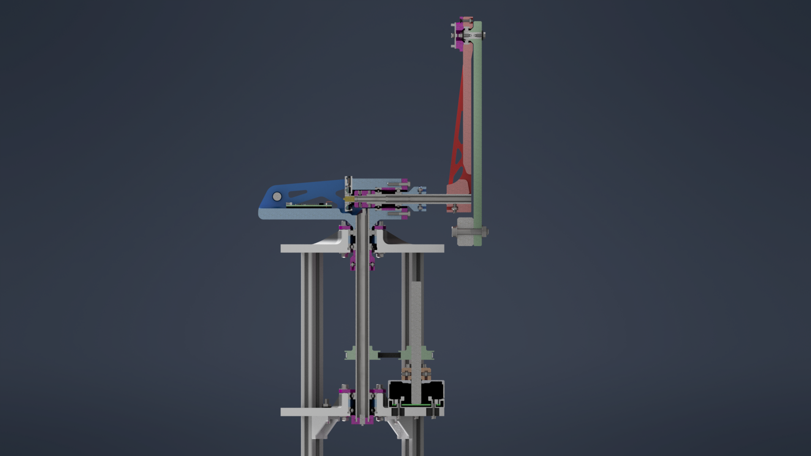

# Rotary Double Inverted Pendulum

A rotary double inverted pendulum, controlled with **reinforcement learning (RL)** and with **model predictive control (MPC)** explored as an alternative.

## Goal

Swing the double pendulum up and move it through all four equilibrium positions as a transition control: both links down, both up, and the two mixed configurations (one link up, one down). The main approach is an RL policy trained in simulation and deployed on the real system. MPC is explored on the same hardware so both methods can be compared on the same task.

## Hardware

- Compact build: 45 cm high, 2 x 20 cm pendulum links, 10 cm base radius
- 3 encoders (arm and both pendulum angles)
- Raspberry Pi 5 and STM32H7
- Motor and sensors connected via CAN
- Slip rings, so cables never tangle during continuous rotation

## Status

CAD is finished and the hardware is being built. The model, simulation and controllers are still to come.

Project page: https://lucaobwegs.com/RL-rotary-inverted-double-pendulum/
